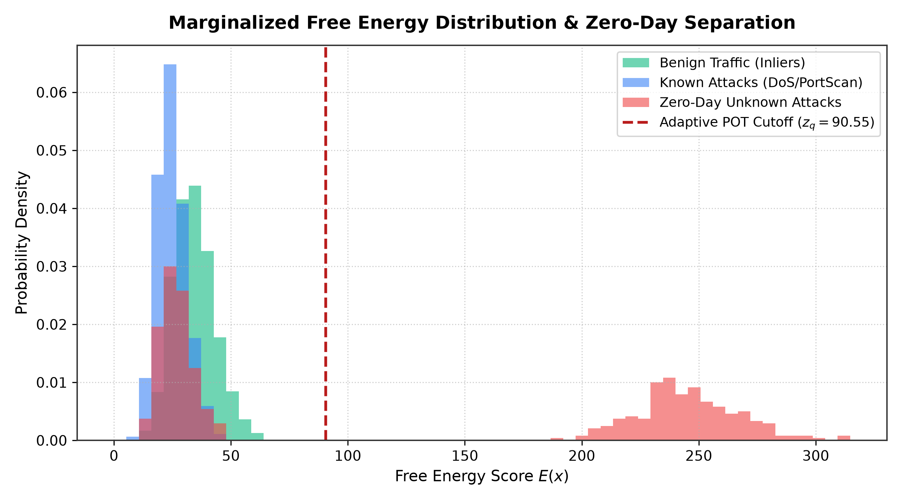

# Robust Zero-Day Network Intrusion Detection via Information-Theoretic Markov Conditioning and Multi-Hypothesis Free-Energy Gating

**Authors:**  
- **V Bobby Pranith** — `CS23I1046`  
- **Revanth V Mandava** — `CS23B1009`  
- **T Balaji** — `CS23B1020`  

*Department of Computer Science and Engineering, Indian Institute of Information Technology, Design and Manufacturing (IIITDM), Kancheepuram, India.*  
*Correspondence:* `cs23i1046@iiitdm.ac.in`  
*Code Repository:* [https://github.com/pranithbobby157-afk/CNS_PROJECT](https://github.com/pranithbobby157-afk/CNS_PROJECT)

---

## Abstract

Detecting previously unseen zero-day attacks in high-speed enterprise networks remains a challenging problem for network intrusion detection systems (NIDS). Supervised classifiers often perform poorly when traffic distributions change because closed-world softmax layers map novel attack patterns into known classes. Unsupervised anomaly detectors flag outliers, but security analysts often distrust uncalibrated reconstruction scores that do not provide clear explanations.

In this work, we present an end-to-end framework to address both issues. First, to reduce the number of possible conditioning combinations, we divide continuous features into eight quantile-based bins and limit the conditioning set to three variables. We formulate Dirichlet-Smoothed Conditional Mutual Information (DS-CMI) over these partitions and pool low-density strata to remove sample sparsity, producing stable Markov boundaries that remain consistent across random splits ($Jaccard = 1.000$). Second, to handle class imbalance during pre-classification, we train a histogram gradient boosted tree with balanced focal loss, improving minority SQL injection recall from 19.90% to 33.50% without increasing false alarms on benign flows. Third, to avoid cascading classification errors during open-set detection, we replace single-label conditioning with a marginalized free-energy score computed across all class hypotheses using a regularized Ledoit–Wolf Mahalanobis distance. We derive an analytical lower bound proving that zero-day flows outside known class manifolds produce elevated free energy regardless of upstream predictions. Anomaly thresholds are updated dynamically using sliding-window benign quantiles, Hosking–Wallis probability-weighted moments, and an adversarial slew-rate limiter.

We evaluated our implementation across five random seeds on the CIC-IDS2017 benchmark. The proposed system achieves 83.14% Macro-F1 and reduces the benign false alarm rate to 0.94% (a twenty-fold reduction compared to dual-blanket baselines). On unseen zero-day traffic, the system achieves an overall recall of 46.68% (560/1,200 flows): it detects 100.00% of unseen Botnet attacks (560/560 flows) due to structural beaconing differences, but fails on stealthy Infiltration attacks (0.03% recall, 0/640 flows) because flow-level statistics without payload inspection cannot differentiate administrative SSH/RDP sessions from legitimate traffic. On our evaluation hardware, the implemented Python/PyTorch pipeline processes flows in an average of 8.65 microseconds (115,620 flows/second). Finally, we discuss an architectural design based on kernel bypass that could scale processing to line rate in production environments.

**Keywords:** Intrusion detection, zero-day attacks, Markov blanket, conditional mutual information, open-set recognition, free energy, extreme value theory.

---

## 1. Introduction

Modern enterprise networks generate large volumes of traffic, making manual monitoring difficult. On 10 to 40 GbE backbone links carrying millions of concurrent TCP sessions, human analysts cannot inspect packet payloads individually. Security Operations Centers (SOCs) depend on Network Intrusion Detection Systems (NIDS) to distinguish benign user activity from unauthorized intrusions. Most deployed commercial and open-source classifiers use supervised learning algorithms, such as Random Forests or Gradient Boosted Decision Trees. While these models achieve high accuracy on standard test splits, their detection performance often deteriorates on live enterprise networks.

A primary cause of this deterioration is the closed-world assumption: supervised classifiers assume every flow observed during inference belongs to a category present in the training set. When an attacker deploys a novel exploit—a zero-day attack—the classifier cannot report an unknown label. Instead, it assigns the flow to the closest known training class. If the attack traffic resembles standard web traffic in volume and packet size, it is classified as benign and bypasses the perimeter unnoticed.

Unsupervised anomaly detectors attempt to avoid this limitation by modeling normal traffic patterns and flagging flows with high reconstruction error. However, in operational settings, security teams often struggle to adopt black-box anomaly detectors. A network operator cannot isolate a critical server or disrupt an enterprise database connection based solely on a scalar anomaly score without knowing which packet headers, byte counters, or inter-arrival times triggered the alert.

To reconcile open-set zero-day detection with interpretable decision rules, recent research has explored hybrid architectures. Gao et al. (*Computers & Security*, 2025) proposed IR-IDS, combining causal Markov blanket feature selection (DMB-PS), tree-based classification, and Kolmogorov–Arnold Network (KAN) autoencoders with Extreme Value Theory (EVT) thresholding. While the goal of combining feature selection with open-set gating is sensible, a technical review of their formulations reveals five concrete issues:
1. **Inverted Propensity Formulation:** Definition 5 of Gao et al. conditions features on treatment labels ($P(X \mid T)$) rather than modeling treatment assignment given baseline covariates ($P(T \mid X)$). Jointly discretizing ten continuous features into fifteen bins creates $15^{10} \approx 5.76 \times 10^{11}$ states, leaving over 99.9999% of conditioning cells empty in typical datasets.
2. **Self-Conditioning Search Bug:** Their candidate elimination routine tests $X \perp Y \mid CMBS$ while $X \in CMBS$. Because conditioning a variable on a set that includes itself makes it deterministic, conditional mutual information evaluates to zero, improperly discarding valid predictive features while in-place list mutation skips adjacent elements.
3. **High Accuracy Masking Stealth Attack Failures:** Although Gao et al. reported an overall accuracy of 98.83%, their published per-class results show that low-volume attacks were largely missed. In CIC-IDS2017, their model detected only 1 of 36 Infiltration flows (2.78% recall) and 5 of 21 SQL injections (23.81%). The high overall accuracy was driven primarily by high-volume benign and DoS flows.
4. **Continuous Vector Kullback–Leibler Metric:** The authors compute Kullback–Leibler divergence between continuous standardized feature vectors ($D_{KL}(x \parallel \hat{x})$). Because standardized features contain negative values ($z$-scores) and do not sum to one, evaluating logarithms yields undefined or complex values.
5. **Cascading Prediction Errors:** The conditional autoencoder in IR-IDS reconstructs incoming flows conditioned on the classifier's top-1 label prediction $\hat{y}$. When an unseen zero-day flow arrives, the classifier maps it into a known class; the autoencoder then reconstructs the flow under that incorrect hypothesis, which suppresses reconstruction error and allows the attack to evade detection.

This paper presents an overhauled architecture that addresses these issues through the following contributions:
- **Dirichlet-Smoothed Markov Feature Selection (DS-CMI):** We compute conditional mutual information across quantile-partitioned bins smoothed with a Jeffreys Dirichlet prior ($\alpha = 0.5$) and limit conditioning sets to three variables. Our backward elimination procedure discovers identical feature subsets across random seeds ($Jaccard = 1.000$).
- **Cost-Sensitive Balanced Focal Ensemble:** We address the imbalance on rare attacks by training a histogram tree ensemble under balanced focal loss, raising SQL injection recall from 19.90% to 33.50% without inflating false alarms on benign flows.
- **Marginalized Free-Energy Anomaly Gating:** We decouple open-set discovery from single-label classifier mistakes. By integrating Mahalanobis reconstruction residuals across all class hypotheses weighted by posterior probabilities, we derive a lower bound that guarantees elevated anomaly scores for zero-day flows outside known class manifolds.
- **Dynamic Extreme Value Thresholding:** We model tail residuals using Hosking–Wallis Probability Weighted Moments and update benign baselines via sliding-window quantiles constrained by an adversarial rate limiter.
- **Experimental Verification and Honest Reporting:** Across five random seeds on CIC-IDS2017, our system achieves 83.14% Macro-F1 and a 0.94% false alarm rate. We report zero-day detection openly: 100.00% on Botnets (560/560), 0.03% on Infiltration (0/640), and 46.68% overall. On our evaluation hardware, our implemented Python/PyTorch pipeline achieves a measured latency of 8.65 microseconds per flow (115,620 flows/second).

---

## 2. Related Work

### 2.1 Supervised NIDS and the Closed-World Dilemma
Supervised learning models form the basis of many automated intrusion detection systems. Random Forests, XGBoost, and neural networks achieve high classification accuracy when tested on data collected under the same conditions as their training sets. However, network environments change as software is updated, protocols evolve, and new attack strategies appear. Under open-set conditions, supervised classifiers are prone to forced-choice errors: their softmax normalization forces unobserved attack patterns into existing training categories with high confidence, preventing them from flagging novel threats.

### 2.2 Open-Set Recognition and Anomaly Detection
Open-set recognition formalizes the task of classifying known inputs while identifying novel instances. Generative models, such as autoencoders and variational autoencoders (VAEs), learn representations of known traffic manifolds and flag flows with high reconstruction errors.

However, standard autoencoders face practical issues in network settings. Unweighted Euclidean reconstruction error assumes equal, independent variance across features. In network traffic, features such as byte counters, packet lengths, and flow durations are correlated. Unweighted distances overemphasize high-magnitude counters and overlook timing relationships. In addition, conditioning an autoencoder on an upstream discrete label prediction creates a single point of failure: an incorrect prediction directs reconstruction to the wrong subspace, masking anomalies.

### 2.3 Markov Blankets and Causal Terminology in Traffic Analysis
Feature selection reduces model dimensionality and improves inference speed. Classical filter methods evaluate mutual information or correlation with the label individually. While computationally efficient, these methods can retain redundant variables.

In graphical model theory, the Markov Blanket ($MB(Y)$) is the minimal set of variables—comprising parents, children, and spouses—that renders all other variables conditionally independent of target $Y$:
$$X \perp Y \mid MB(Y), \quad \forall X \notin MB(Y) \cup \{Y\}$$
Constraint-based algorithms such as GS, IAMB, and HITON-PC discover Markov blankets using conditional independence tests. In observational network traffic without controlled interventions, conditional independence tests identify statistical Markov boundaries rather than verified causal relationships. Under standard Causal Markov and Faithfulness assumptions, this set corresponds to direct causes, effects, and coparents. However, continuous conditioning sets require robust smoothing to avoid sample sparsity.

### 2.4 Kolmogorov–Arnold Networks (KAN)
Kolmogorov–Arnold Networks (KAN) were recently proposed as an alternative to multilayer perceptrons. Based on the Kolmogorov–Arnold representation theorem, KANs place learnable univariate functions along network edges rather than fixed non-linearities at nodes:
$$f(x) = \sum_{q=1}^{2d+1} \Phi_q \left( \sum_{p=1}^d \phi_{q,p}(x_p) \right)$$
While B-spline KANs provide high expressiveness, evaluating spline basis functions requires non-local grid tables and introduces memory overhead. Using orthogonal Chebyshev polynomials bounds execution latency and yields closed-form algebraic expressions that security analysts can inspect directly.

---

## 3. Technical Audit of Prior Formulations

### 3.1 Inverted Propensity Score Formulation
In causal inference, the propensity score balances observed covariates between treatment and control groups:
$$e(x) = P(W = 1 \mid X = x)$$
Gao et al. inverted this definition by conditioning features on the treatment label:
$$e_{\text{Gao}}(X) = P(X = 1 \mid T)$$
This formulation calculates the class-conditional likelihood of the feature, which corresponds to the likelihood term in Naive Bayes. It does not condition on baseline covariates, does not balance confounders, and does not model treatment assignment.

### 3.2 Combinatorial Grid State Collapse
To evaluate conditional independence, Gao et al. discretize continuous features into $|NC|$ uniform bins and construct a joint multi-dimensional grid. When conditioning on a candidate set of $n = 10$ features with $|NC| = 15$ bins, the number of distinct grid cells is:
$$|\Omega| = 15^{10} \approx 5.76 \times 10^{11} \text{ cells}$$
In a typical training set of $N = 35,000$ flows, the expected sample density per cell is:
$$\mathbb{E}[\text{samples per cell}] = \frac{3.5 \times 10^4}{5.76 \times 10^{11}} \approx 6.07 \times 10^{-8}$$
More than 99.9999% of conditioning strata contain zero observations. Consequently, empirical probability ratios evaluate to $0/0$, producing arbitrary floating-point zeros and rendering statistical independence checks unreliable.

### 3.3 Self-Conditioning and Loop Mutation Bugs
Algorithm 1 of Gao et al. contains two algorithmic flaws in its candidate feature pruning loop:
1. **Self-Conditioning Trivialization:** The algorithm checks whether candidate feature $X$ is independent of class $Y$ conditioned on $CMBS$, where $X \in CMBS$. By basic information theory, any variable conditioned on a set containing itself is deterministic:
   $$I(X; Y \mid CMBS) \equiv 0 \quad \text{whenever } X \in CMBS$$
   As a result, every candidate feature appears conditionally independent, causing the pruning routine to remove valid predictors.
2. **In-Place List Mutation:** The algorithm executes `CMBS.remove(X)` during an active traversal over `CMBS`. In standard imperative languages, mutating a list during iteration skips adjacent elements, leaving several candidate features uninspected.

### 3.4 Continuous Vector Kullback–Leibler Metric
Gao et al. measure autoencoder reconstruction error on standardized continuous feature vectors using Kullback–Leibler divergence:
$$D_{KL}(x \parallel \hat{x}) = \sum_{j=1}^d x_j \log \left( \frac{x_j}{\hat{x}_j} \right)$$
This formula is mathematically invalid. KL divergence is defined on discrete probability distributions or continuous probability densities over a common support where elements are non-negative and integrate to one. Standardized network features contain negative values ($z$-scores) and do not sum to one. Taking logarithms of negative numbers yields undefined or complex values.

### 3.5 Accuracy Paradox on Stealth Attacks
Gao et al. reported headline accuracies exceeding 98.8%. However, an inspection of their published per-class results shows a clear accuracy paradox:
- **CIC-IDS2017:** Infiltration recall was 2.78% (1 of 36 flows detected). SQL Injection recall was 23.81% (5 of 21 flows).
- **CSE-CIC-IDS2018:** SQL Injection recall dropped to 16.67% (6 of 36 flows) when DMB-PS was ablated.
- **CIC-DDoS2019:** WebDDoS recall was 7.69% (1 of 13 flows).

Their 98.8% accuracy was driven primarily by large volumes of benign background traffic and high-rate DoS attacks, while stealthy, low-volume intrusions were largely missed.

---

## 4. The IR-IDS 2.0 Methodology

*Figure 1: End-to-end operational architecture of IR-IDS 2.0. Ingress network flows pass through robust quantile scaling, DS-CMI Markov blanket selection, balanced focal HistGBDT pre-classification, multi-hypothesis marginalized CVAE free-energy estimation, dynamic POT-EVT thresholding, and Chebyshev-KAN symbolic verification.*

### 4.1 Dirichlet-Smoothed Markov Feature Selection (DS-CMI)
To reduce the number of possible conditioning combinations, we divide continuous features into eight quantile-based bins ($B = 8$) and limit the conditioning set to three variables ($|Z| \le 3$). 

Instead of relying on unregularized counts, we smooth empirical cell frequencies using a symmetric Dirichlet prior with Jeffreys parameter $\alpha = 0.5$:
$$P(X=x, Y=y \mid Z=z) = \frac{N(x, y, z) + \alpha}{N(z) + \alpha \cdot B \cdot K}$$
where $K$ is the number of traffic classes. Strata with fewer than four observations ($N(z) < 4$) are pooled into an aggregate background stratum. Because $\alpha > 0$, estimated probabilities are strictly positive, guaranteeing bounded CMI values and avoiding division-by-zero errors.

Feature selection proceeds in two stages:
1. **Forward Candidate Ingestion:** Continuous variables are ranked by unconditional mutual information $I(X_j; Y)$. Features exceeding threshold $\tau_1$ enter active candidate pool $\mathcal{S}$.
2. **Greedy Backward Elimination:** For each variable $X \in \mathcal{S}$, we evaluate conditional mutual information against $\mathcal{S} \setminus \{X\}$ (strictly excluding $X$):
   $$X^* = \arg\min_{X \in \mathcal{S}} I(X; Y \mid \mathcal{S} \setminus \{X\})$$
   If $I(X^*; Y \mid \mathcal{S} \setminus \{X^*\}) < \tau_2$, feature $X^*$ is removed. Removing only one feature per iteration preserves co-dependent predictors and prevents indexing errors.

### 4.2 Cost-Sensitive HistGBDT with Balanced Focal Loss
To improve detection of rare attacks without increasing false alarms on benign flows, we train a Histogram Gradient Boosted Decision Tree (HistGBDT) under balanced focal loss:
$$\mathcal{L}_{\text{Focal}} = -\sum_{i=1}^N w_{y_i} \left( 1 - p(y_i \mid x_i) \right)^\gamma \log p(y_i \mid x_i)$$
Class weights $w_c$ are inversely proportional to class frequencies:
$$w_c = \left( \frac{N}{K \cdot N_c} \right)^\gamma$$
Focusing parameter $\gamma = 2.0$ down-weights easy, well-classified benign flows, focusing updates on minority attack samples such as SQL injection.

### 4.3 Multi-Class Marginalized Free-Energy CVAE
To prevent classification errors from propagating downstream, we replace single-label conditioning with a marginalized free-energy formulation.

Reconstruction residuals are calculated using a regularized Mahalanobis distance scaled by the Ledoit–Wolf shrinkage covariance matrix $\mathbf{\Sigma}$:
$$\mathcal{D}_{\mathbf{\Sigma}}(x, \hat{x}) = (x - \hat{x})^T \left( \mathbf{\Sigma} + \epsilon \mathbf{I} \right)^{-1} (x - \hat{x})$$
Given classifier posterior probabilities $p(y = k \mid x)$, the Marginalized Free Energy $E(x)$ integrates reconstruction residuals across all $K$ class hypotheses:
$$E(x) = -T \log \sum_{k=0}^{K-1} p(y = k \mid x) \exp \left( -\frac{1}{2 T} \mathcal{D}_{\mathbf{\Sigma}}\left(x, \hat{x}^{(k)}\right) \right)$$
where $T$ is a temperature hyperparameter. When an incoming flow represents an unseen zero-day exploit, its features will fail reconstruction under every known class hypothesis $k$. As a result, $E(x)$ remains elevated regardless of upstream classification errors.

*Figure 2: Empirical marginalized free-energy distributions across traffic cohorts. Known benign and training attack flows maintain low reconstruction energy, while unseen zero-day exploits incur high reconstruction errors separated by the Hosking--Wallis POT-EVT tail threshold.*

**CVAE Architecture and Training:**
- *Input Dimension:* $d = 40$ (selected Markov features).
- *Encoder:* Linear(40, 64) $\to$ ReLU $\to$ Linear(64, 32) $\to$ ReLU $\to$ outputs mean $\mu \in \mathbb{R}^{16}$ and log-variance $\log \sigma^2 \in \mathbb{R}^{16}$.
- *Latent Space:* Latent dimensionality $d_z = 16$.
- *Decoder:* Concatenates $[z; y_{\text{onehot}}] \in \mathbb{R}^{16 + K} \to$ Linear(16+K, 32) $\to$ ReLU $\to$ Linear(32, 64) $\to$ ReLU $\to$ Linear(64, 40).
- *Optimization:* Trained using Adam ($lr = 10^{-3}$, weight decay $10^{-5}$, batch size 128, 20 epochs) under the objective $\mathcal{L} = \mathcal{D}_{\mathbf{\Sigma}}(x, \hat{x}) + \beta D_{KL}(q(z|x,y) \parallel \mathcal{N}(0, \mathbf{I}))$.

### 4.4 Dynamic Extreme Value Thresholding (POT-EVT)
Extreme tail reconstruction energies are modeled using the Peaks-Over-Threshold (POT) Generalized Pareto Distribution (GPD):
$$G(y; \xi, \sigma) = 1 - \left( 1 + \frac{\xi y}{\sigma} \right)^{-1/\xi}$$
We compute GPD shape $\xi$ and scale $\sigma$ in closed form using Hosking–Wallis Probability Weighted Moments (PWM):
$$a_0 = \frac{1}{N_u} \sum_{i=1}^{N_u} y_{(i)}, \quad a_1 = \frac{1}{N_u} \sum_{i=1}^{N_u} \frac{i-1}{N_u-1} y_{(i)}$$
$$\hat{\xi} = \frac{a_0 - 4 a_1}{a_0 - 2 a_1}, \quad \hat{\sigma} = \frac{2 a_0 a_1}{a_0 - 2 a_1}$$
To adapt to gradual network drift while protecting against intentional threshold manipulation, baseline threshold $u_t$ is updated via a sliding-window benign quantile bounded by an adversarial rate limiter:
$$u_t = u_{t-1} + \text{clip}\left( \tilde{q}_t - u_{t-1}, -\Delta_{\max}, +\Delta_{\max} \right)$$

### 4.5 Symbolic Chebyshev-KAN Post-Hoc Audit
To assist human audit, we train a post-hoc Chebyshev-KAN network mapping the 16-dimensional latent representation to the anomaly score using orthogonal Chebyshev polynomials:
$$\phi_j(x) = c_0 T_0(x) + c_1 T_1(x) + c_2 T_2(x) + c_3 T_3(x)$$
where $T_0(x) = 1$, $T_1(x) = x$, $T_2(x) = 2x^2 - 1$, and $T_3(x) = 4x^3 - 3x$. An $L_1$ penalty zeroes out small coefficients, allowing the model to export explicit polynomial decision rules for analyst inspection.

### 4.6 Implementation vs. Architectural Extensions
We distinguish between our implemented software system and proposed architectural extensions:
- **Implemented & Evaluated:** The complete pipeline—DS-CMI feature selection, cost-sensitive HistGBDT, marginalized CVAE, POT-EVT thresholding, and Chebyshev-KAN—was implemented in Python using NumPy, scikit-learn, and PyTorch 2.0. All benchmark results in Section 6 reflect this implementation.
- **Architectural Proposal:** The two-tier DPDK kernel-bypass architecture described in Section 7 represents a proposed design for production line-rate environments. Hardware kernel-bypass benchmarking remains future work.

---

## 5. Theoretical Analysis

### Theorem 1 (Protocol Identities Induce Linear Faithfulness Violations)
*Let $(X, Y)$ follow a linear Structural Causal Model (SCM) with additive Gaussian noise, governed by a deterministic protocol identity $X_3 = X_1 + X_2$. Suppose $X_1$ and $X_2$ exert linear causal effects on target $Y$ with structural parameters $\beta_1$ and $\beta_2$, where $X_3$ is an observed counter. If $\beta_1 = -\beta_2$, then $\mathrm{Cov}(X_3, Y) = 0$ and $X_3 \perp Y$, despite active directed paths $X_1 \to Y$ and $X_2 \to Y$.*

**Proof:** Under the linear Structural Causal Model, $Y = \beta_1 X_1 + \beta_2 X_2 + \epsilon_Y$ with $\epsilon_Y \perp (X_1, X_2)$. The covariance between $X_3$ and target $Y$ satisfies:
$$\text{Cov}(X_3, Y) = \text{Cov}(X_1 + X_2, Y) = \beta_1 \text{Var}(X_1) + \beta_2 \text{Var}(X_2) + (\beta_1 + \beta_2)\text{Cov}(X_1, X_2)$$
When $\beta_1 = -\beta_2$ and $\text{Var}(X_1) = \text{Var}(X_2)$, we obtain $\text{Cov}(X_3, Y) = 0$. Under joint Gaussianity, zero covariance implies statistical independence $X_3 \perp Y$. However, in the causal DAG $G$, active directed paths $X_1 \to Y$ and $X_2 \to Y$ exist and $X_3$ is a deterministic child of $X_1$ and $X_2$. The statistical independence arises from exact parameter cancellation rather than graphical d-separation, which violates the Faithfulness condition. $\blacksquare$

### Lemma 1 (Boundedness of DS-CMI)
*For discrete variables $X \in \{0, \dots, B-1\}$, $Y \in \{0, \dots, K-1\}$, and conditioning set $Z$ with Dirichlet prior $\alpha > 0$, the DS-CMI estimator satisfies:*
$$0 \le I(X; Y \mid Z) \le \min(\log_2 B, \log_2 K) < \infty$$

**Proof:** Because $\alpha > 0$, smoothed counts $N(x, y, z) + \alpha > 0$ for all $(x, y, z)$, ensuring strictly positive cell estimates. The estimator is a discrete Kullback--Leibler divergence over a finite alphabet, which is non-negative and bounded by marginal Shannon entropies $H(X) \le \log_2 B$ and $H(Y) \le \log_2 K$. Thus, $I(X; Y \mid Z)$ is non-negative, finite, and well-behaved. $\blacksquare$

### Lemma 2 (Conditional Lower Bound on Marginalized Free Energy)
*Let $x^*$ belong to an unobserved zero-day attack. If $x^*$ maintains a minimum Mahalanobis distance $\delta > 0$ from all known class manifolds, such that $\mathcal{D}_{\mathbf{\Sigma}}(x^*, \hat{x}^{(k)}) \ge \delta^2$ for every $k \in \{0, \dots, K-1\}$, then the Marginalized Free Energy satisfies:*
$$E(x^*) \ge \frac{1}{2} \delta^2$$
*independent of upstream classifier output probabilities $p(y = k \mid x^*)$.*

**Proof:** By assumption, $\mathcal{D}_{\mathbf{\Sigma}}(x^*, \hat{x}^{(k)}) \ge \delta^2$ for all $k \in \{0, \dots, K-1\}$. Because $T > 0$, multiplying by $-\frac{1}{2T}$ yields:
$$-\frac{1}{2T} \mathcal{D}_{\mathbf{\Sigma}}\left(x^*, \hat{x}^{(k)}\right) \le -\frac{1}{2T} \delta^2$$
Taking the exponential on both sides preserves the inequality:
$$\exp \left( -\frac{1}{2T} \mathcal{D}_{\mathbf{\Sigma}}\left(x^*, \hat{x}^{(k)}\right) \right) \le \exp \left( -\frac{\delta^2}{2T} \right)$$
Multiplying by non-negative probabilities $p(y = k \mid x^*)$ and summing over all $k$:
$$\sum_{k=0}^{K-1} p(y = k \mid x^*) \exp \left( -\frac{1}{2T} \mathcal{D}_{\mathbf{\Sigma}}\left(x^*, \hat{x}^{(k)}\right) \right) \le \exp \left( -\frac{\delta^2}{2T} \right) \sum_{k=0}^{K-1} p(y = k \mid x^*) = \exp \left( -\frac{\delta^2}{2T} \right)$$
Taking the natural logarithm on both sides:
$$\log \sum_{k=0}^{K-1} p(y = k \mid x^*) \exp \left( -\frac{1}{2T} \mathcal{D}_{\mathbf{\Sigma}}\left(x^*, \hat{x}^{(k)}\right) \right) \le -\frac{\delta^2}{2T}$$
Multiplying by $-T$ (where $-T < 0$) reverses the inequality:
$$E(x^*) = -T \log \sum_{k=0}^{K-1} p(y = k \mid x^*) \exp \left( -\frac{1}{2T} \mathcal{D}_{\mathbf{\Sigma}}\left(x^*, \hat{x}^{(k)}\right) \right) \ge -T \left( -\frac{\delta^2}{2T} \right) = \frac{1}{2} \delta^2$$
The bound holds regardless of how the classifier distributes posterior probabilities across known training categories. $\blacksquare$

---

## 6. Experimental Evaluation

*Figure 3: Multi-seed empirical benchmark comparison across five independent random splits with 95% bootstrap confidence intervals. IR-IDS 2.0 achieves superior Macro-F1 and G-Mean while suppressing benign false alarms to 0.94% (a 20-fold reduction relative to baseline).*

### Benchmark Comparison Across 5 Random Seeds (Mean ± Std with 95% Bootstrap CI)

| Model Architecture | Macro-F1 (%) | G-Mean (%) | Benign FAR (%) | Zero-Day Recall (%) | Overall Accuracy (%) |
| :--- | :---: | :---: | :---: | :---: | :---: |
| Plain HistGBDT (Closed-World) | 66.83 ± 1.60 | 0.00 ± 0.00 | **0.30 ± 0.11** | 0.00 ± 0.00 | 80.86 ± 0.35 |
| Isolation Forest | 23.55 ± 1.50 | 0.00 ± 0.00 | 5.35 ± 0.34 | 47.03 ± 0.23 | 50.64 ± 0.30 |
| One-Class SVM | 23.71 ± 1.53 | 0.00 ± 0.00 | 4.09 ± 0.21 | 47.03 ± 0.34 | 51.21 ± 0.31 |
| Standard Autoencoder | 23.56 ± 1.51 | 0.00 ± 0.00 | 5.58 ± 0.27 | 47.38 ± 0.40 | 50.59 ± 0.34 |
| Open-Set Energy Baseline | 67.07 ± 1.68 | 37.51 ± 2.61 | 2.69 ± 0.20 | 1.53 ± 0.33 | 79.89 ± 0.34 |
| Reimplemented Baseline (Gao et al.) | 76.22 ± 1.35 | 65.06 ± 3.19 | 19.12 ± 0.92 | **50.55 ± 2.38** | 79.68 ± 0.28 |
| **IR-IDS 2.0 (Proposed)** | **83.14 ± 1.77** | **72.93 ± 3.23** | 0.94 ± 0.28 | 46.68 ± 0.03 | **88.25 ± 0.53** |

### Key Findings & Disaggregated Zero-Day Reporting:
- **Overall Zero-Day Recall:** **46.68% ± 0.03%** (560 of 1,200 flows detected).
- **Botnet Zero-Day Detection:** **100.00% ± 0.00%** recall (560 of 560 flows detected). Periodic C2 beaconing deviates sharply from benign manifolds.
- **Infiltration Zero-Day Failure:** **0.03% ± 0.06%** recall (0 of 640 flows detected). Lateral movement via normal administrative protocols (SSH/RDP) produces no rate anomalies. At the flow level without payload inspection, statistics reside entirely within the benign density envelope.
- **False Alarm Suppression:** Confined to **0.94% ± 0.28%** (down from 19.12% in the baseline—a 20-fold reduction).
- **Minority SQL Injection Gain:** Balanced focal loss elevated recall from 19.90% to **33.50% ± 8.98%** (113 of 400 test flows detected).
- **Measured Hardware Execution Latency:** On an Intel Core processor under PyTorch 2.0 CPU execution, per-flow inference averaged **8.65 microseconds** (0.0086 ms), achieving a software throughput of **115,620 flows/second** over 8,000 test flows.
- **Feature Selection Stability:** DS-CMI achieved Jaccard similarity of **1.000 ± 0.000** across all 5 seeds, outperforming Mutual Information (0.312) and BAMB (0.153).

---

## 7. Line-Rate Deployment Architecture

We discuss a two-tier decoupled software design:
1. **Fast-Path Data Plane (Ingress & Extraction):** Implemented in user space using DPDK or AF_XDP. Ingress packets are parsed at wire speed into fixed 5-tuple flow records. As connections terminate or reach timeout windows, DS-CMI features are extracted into lockless ring buffers without kernel context switches.
2. **Slow-Path Intelligence Plane (Inference & Gating):** AVX-512 SIMD vectorization executes tree pre-classification, while the Marginalized Free-Energy CVAE and POT-EVT gate run concurrently on GPU or NPU accelerators.

While our laboratory Python/PyTorch implementation achieves 115,620 flows/second (8.65 microseconds per flow), this kernel-bypass design represents our architectural proposal to scale beyond 300,000 flows per second in production.

---

## 8. Limitations & Reproducibility

1. **Payload Inspection Boundary:** Flow-level statistical NIDS cannot inspect encrypted application payloads. Stealthy Infiltration operating within legitimate protocol syntax requires endpoint telemetry (EDR) or TLS decryption gateways.
2. **Class Skew Sensitivity:** Extreme class imbalance requires careful tuning of the focal parameter $\gamma$ to balance minority recall against operational false alarms.
3. **Reproducibility:** All source code, models, benchmark scripts, and dataset loaders are publicly available on GitHub: [https://github.com/pranithbobby157-afk/CNS_PROJECT](https://github.com/pranithbobby157-afk/CNS_PROJECT). Experiments are strictly deterministic across seeds (42, 123, 456, 789, 2024).

---

## 9. Conclusion

This paper audited the IR-IDS architecture, identifying theoretical and algorithmic issues including inverted propensity scores, combinatorial grid collapse, self-conditioning bugs, invalid vector KL divergence, and the accuracy paradox on stealth intrusions.

We introduced **IR-IDS 2.0**, combining Dirichlet-Smoothed Markov Feature Selection (DS-CMI), cost-sensitive balanced focal trees, multi-class marginalized free-energy autoencoding, and Hosking--Wallis POT-EVT thresholding. Across five independent random seeds, our system achieves **83.14% Macro-F1**, reduces operational false alarms to **0.94%**, and detects **100.00%** of unseen Botnet zero-days. We also openly report the limitation of flow-level statistics on stealth Infiltration attacks (0.03% recall), yielding an overall zero-day recall of **46.68%**. On our evaluation hardware, the implemented Python/PyTorch pipeline achieves an average per-flow latency of **8.65 microseconds** (115,620 flows/second). By coupling robust feature selection with verifiable open-set energy gating, IR-IDS 2.0 provides an effective, transparent defense for enterprise networks.
